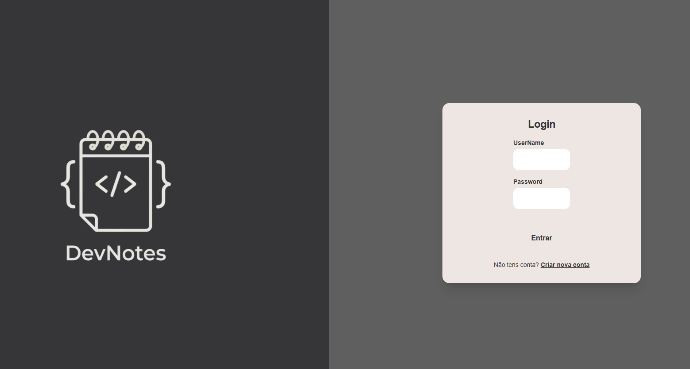
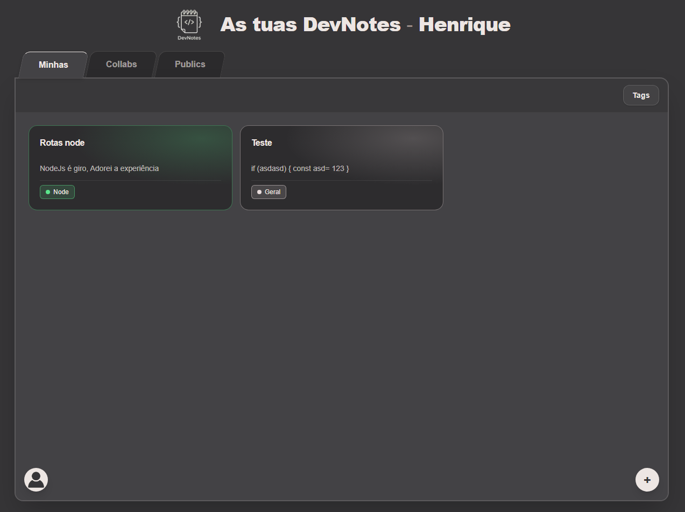
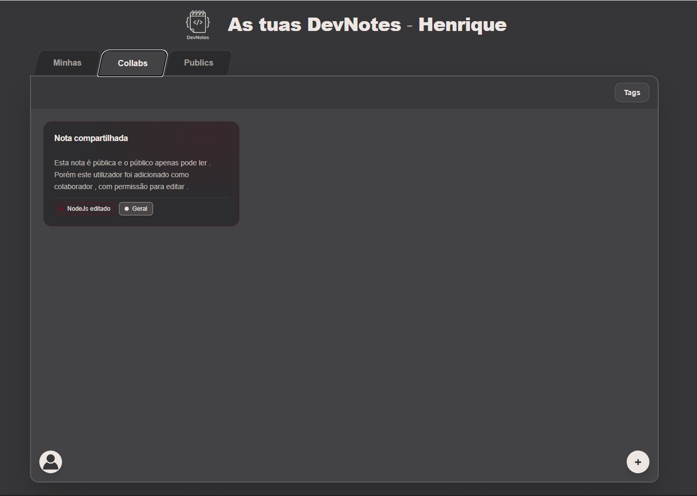
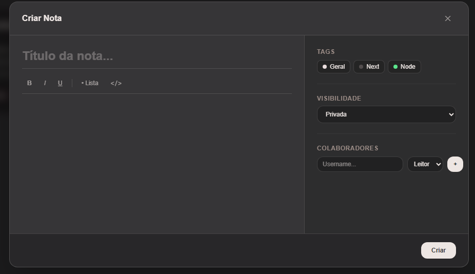
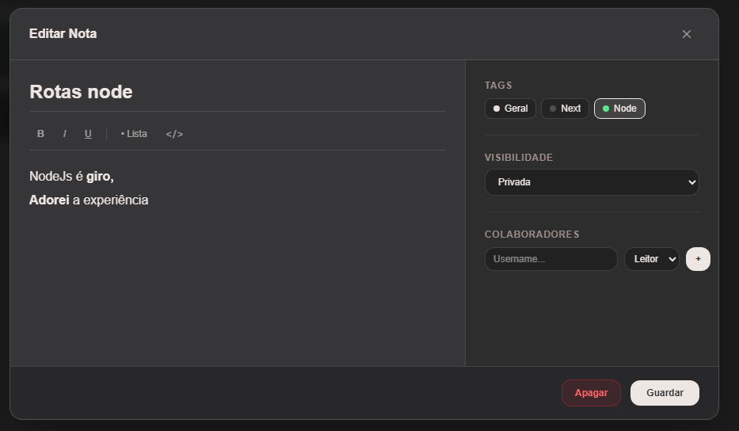
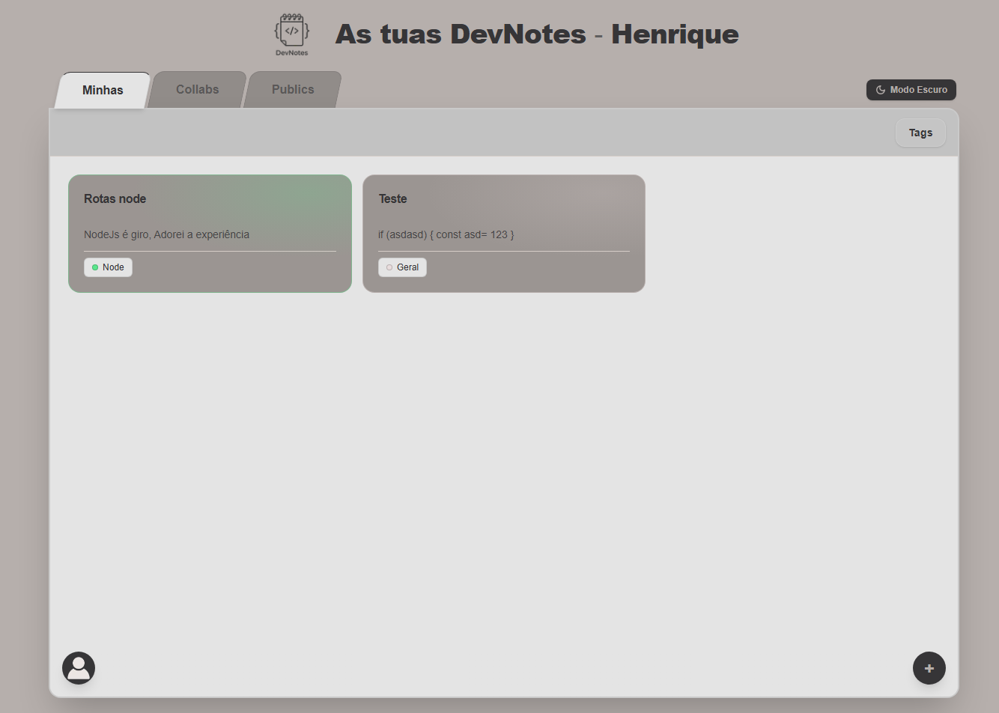

    <picture>
        <source media="(prefers-color-scheme: dark)" srcset="./next/public/logo/logo-titulo.png" />
        <source media="(prefers-color-scheme: light)" srcset="./next/public/logo/logo-titulo-dark.png" />
        
  </picture>

# Dev-Notes

Note-taking web app for developers, with a tag system to organize and link notes. Built to practice a decoupled architecture, with a Node.js (Fastify) backend and a Next.js frontend, and to implement authentication from scratch instead of relying on a third-party auth service.

🔗 [Live Demo](https://dev-notes-nu-khaki.vercel.app/)

## Features

* User registration and login with JWT authentication (access token sent via browser cookies)
* Create, edit and delete notes
* Tag system: create and remove tags, and assign multiple tags to each note
* Note privacy: notes can be public (visible to everyone) or private
* Public notes have a configurable permission level for visitors: viewer or editor
* Collaboration: each note can have multiple collaborators, each with its own role (editor or viewer)

## Tech Stack

* Backend: Node.js + Fastify
* Frontend: Next.js + TypeScript
* Database: Neon (PostgreSQL) with Prisma as ORM
* Authentication: JWT, implemented manually

## What I Learned

* Implementing JWT authentication from scratch: token generation and validation, and sending it via cookies
* Building a REST API with Fastify
* Modeling relational data with Prisma
* Connecting a separate backend to a Next.js frontend

## Deployment notes

The backend is hosted on Render's free tier, so the server sleeps when idle and the first request can take 50+ seconds to respond.

## Screenshots

